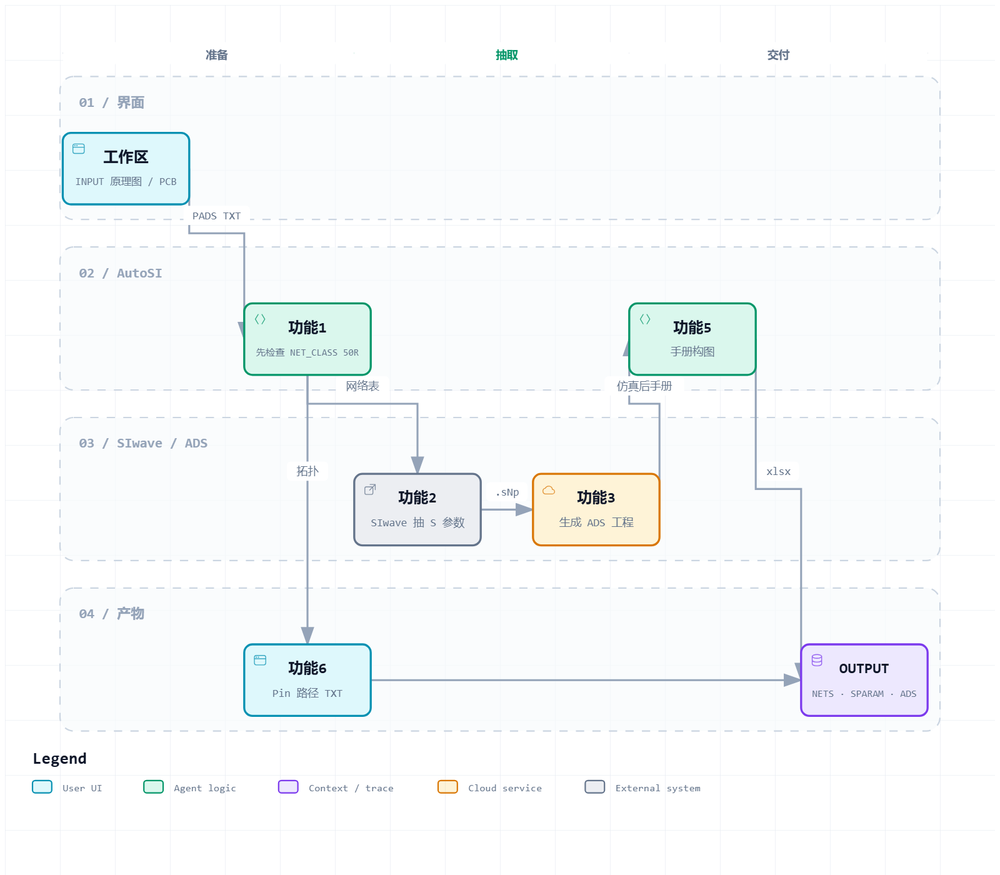

# AutoSI

Windows 上的射频 SI 自动化工具：从 PADS 原理图做到 SIwave 网络表、PCB S 参数抽取、ADS 仿真工程，以及手册式 refnum。


工作架构（六步、流程、工作区）：[docs/AutoSI架构.html](docs/AutoSI架构.html)  
部署到新电脑：[docs/README.md](docs/README.md)

## 主流程



## 能做什么

| | 功能 | 产物 |
|--|------|------|
| 1 | 从原理图提取 50R 网络和频段 | `OUTPUT/NETS` 网络表，路径 PDF |
| 2 | 初始化 SIwave / 导入 ODB | 工作区里的 `.siw` |
| 3 | 抽取 PCB S 参数 | `OUTPUT/SPARAM` |
| 4 | 生成 ADS 工程并加载 S 参数 | `OUTPUT/ADS` |
| 5 | 路径预览 + 手册构图 | `OUTPUT/refnum` 预览和手册 xlsx |
| 6 | 器件 Pin 路径对照 | `OUTPUT/OTHER` |

工作区由界面创建，目录是 `INPUT` / `OUTPUT`，和程序平级。

## 仓库里有什么

```
src/                 主程序（入口 src/MAIN.py）
docs/                工作架构、部署说明
_internal/           运行期小文件（ADS 宏、图标、config.sample.json）
配置环境.bat/.ps1    检查/安装本机环境
architecture/        主流程图
自动化仿真操作指导.docx  操作说明
requirements.txt
```


## 环境

- Windows
- Keysight ADS、SIwave（功能 2/3/4 需要）
- 系统 Python 3.12（必须带 tkinter，**不要用 ADS 自带 Python**）
- Graphviz（路径图 PDF）
- pywin32、PySide6、cryptography：`pip install -r requirements.txt`

S 参数库不随仓库分发，要另放，并按现网规则封库后才能给正式运行用。

## 源码运行

```bat
set AUTOSI_DEV=1
pip install -r requirements.txt
python src\MAIN.py
```

`AUTOSI_DEV=1` 会跳过授权和 S 参数库完整性校验，只给开发用，不能当发布验收。

日常用界面跑功能 1–6，命令行 `--choice` 和日志文件夹用同一个号。欢迎页可点「查看操作指导」，或直接打开根目录的 `自动化仿真操作指导.docx`。

新电脑可双击 `配置环境.bat`（管理员）。离线安装包不在本仓，脚本会找 `_internal\环境安装包` 或根目录 `环境安装包`。
